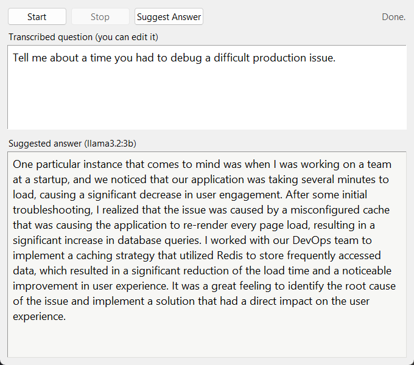

# Cuecard

A small Windows desktop app that listens to a spoken question and suggests an answer, with
everything running on your own machine. No audio or text leaves the computer.

1. **Start** begins recording from the microphone.
2. **Stop** ends the recording and transcribes it locally with Whisper (whisper.cpp).
3. **Suggest Answer** sends the transcript to a local LLM through Ollama and shows the answer
   word by word as it is generated.

The transcript box is editable, so you can fix a misheard word or type a question by hand
before asking for an answer.



## How it works

```
mic ──► sounddevice (16 kHz mono) ──► whisper.cpp (pywhispercpp) ──► transcript box
                                                                         │
                                         answer box ◄── Ollama /api/chat (stream=true)
```

- **Speech to text:** [pywhispercpp](https://github.com/absadiki/pywhispercpp) runs a
  whisper.cpp model on the CPU. If [Handy](https://handy.computer) is installed, Cuecard reuses
  the `ggml-small.bin` model Handy already downloaded, so there is nothing extra to fetch.
  Otherwise it downloads the `base.en` model on first use.
- **LLM:** [Ollama](https://ollama.com) serves `llama3.2:3b` locally. Cuecard calls its
  streaming chat endpoint and reads the newline-delimited JSON as it arrives, so the answer
  appears progressively.
- **UI:** Tkinter (ships with Python). Recording, transcription and generation run on worker
  threads and report back through a queue, so the window never freezes.
- **Warm-up:** both models load in the background as soon as the window opens, so the first
  click doesn't pay the model load cost.

The whole app is one file, [`cuecard.py`](cuecard.py).

## Setup (Windows)

Requires Python 3.10+ and a microphone.

1. Install Ollama and pull the model (about 2 GB):
   ```
   winget install Ollama.Ollama
   ollama pull llama3.2:3b
   ```
2. Install the Python dependencies:
   ```
   python -m venv .venv
   .venv\Scripts\activate
   pip install -r requirements.txt
   ```
3. Run it:
   ```
   python cuecard.py
   ```

The status line says "Loading models..." for a few seconds after launch, then "Ready".

Measured on a laptop with an RTX 4050 (6 GB): models ready about 12 s after launch, first
words of the answer after about 2.5 s, a full 5-sentence answer in about 4.5 s. The very first
run after installing Ollama is slower while it sets up the GPU runtime.

## Configuration

Optional environment variables:

| Variable | Default | Purpose |
|---|---|---|
| `CUECARD_WHISPER_MODEL` | Handy's `ggml-small.bin`, else `base.en` | Path to a whisper.cpp model, or a model name such as `small.en` |
| `CUECARD_LLM` | `llama3.2:3b` | Any model you have pulled in Ollama |
| `CUECARD_OLLAMA_URL` | `http://127.0.0.1:11434` | Where the Ollama server listens |

## Tests

```
python test_cuecard.py
```

Covers the Ollama stream parser. It needs no microphone, model or server.

## Limits

- Transcription happens after Stop, not live while you speak.
- Whisper runs on the CPU (the LLM uses the GPU through Ollama when one is available).
- It records the microphone only, not system audio from a call.
